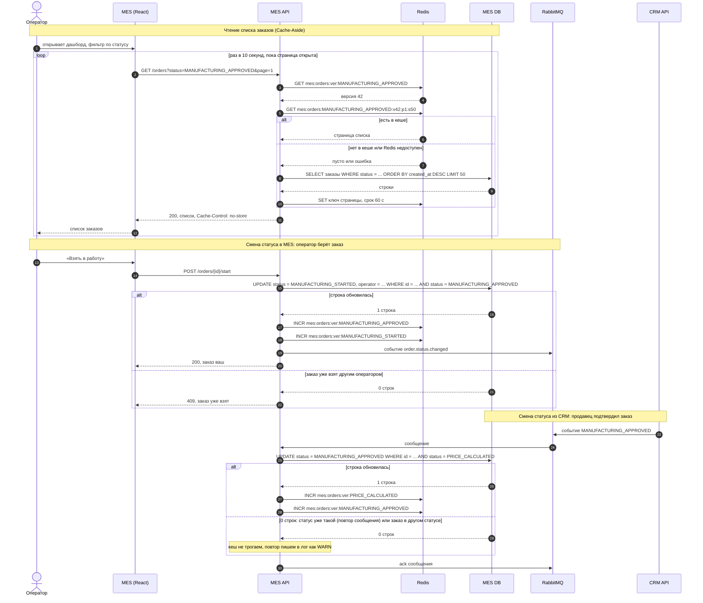
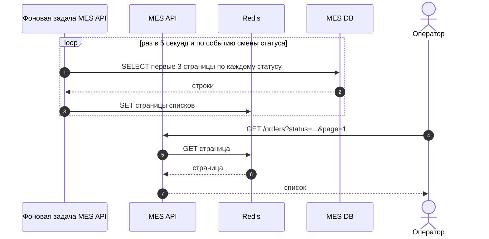

# Архитектурное решение по кешированию

## Мотивация

Главная страница MES — дашборд со списком заказов в работе по статусам. Она грузится долго, и операторы жалуются. Фильтр по статусам и пагинация не помогли. Похоже, дело не в объёме ответа, а в самом запросе: каждый оператор при каждом обновлении страницы заставляет MES API выбирать заказы из MES DB с фильтром и сортировкой по дате. Заказов с каждым месяцем больше (+100 в месяц плюс поток от партнёров), а база одна, на чтение и запись. Её же нагружают расчёт стоимости и заказы через API.

Для операторов скорость критична: кто первым взял новый заказ, тот и получает за него оплату. Поэтому страницу обновляют часто, и одинаковые запросы «покажи новые заказы в статусе X» приходят от всех операторов сразу.

Что предлагаю кешировать: ответ MES API на запрос списка заказов для дашборда, то есть страницу списка заказов в конкретном статусе. Это хорошие данные для кеша:
- читаются гораздо чаще, чем меняются: все операторы смотрят одни и те же списки, а статус одного заказа меняется несколько раз за недели;
- одинаковы для всех операторов, персональных данных покупателей в карточке дашборда нет (номер заказа, статус, дата, тип изделия, сложность);
- момент изменения точно известен: статус меняется только через MES API, сам или по сообщению из CRM.

Что кеш должен решить:
- главная страница MES открывается быстрее 1 секунды для 95% запросов (ориентир из задания 1);
- запросы списка почти не доходят до MES DB, и база освобождается под расчёт стоимости и запись статусов;
- оператор видит новый заказ при следующем обновлении страницы, то есть не позже чем через 10 секунд (период опроса в MES), а не через минуту устаревшего кеша.

Что в кеширование не входит: взятие заказа в работу и любые записи. Кто взял заказ, решает только база в транзакции, кеш здесь не участвует. Иначе два оператора могли бы взять один заказ по устаревшему списку.

Элементы системы: MES (React), MES API, MES DB, новый Redis, а также CRM API и RabbitMQ, потому что часть смен статуса приходит из CRM.

## Предлагаемое решение

### Клиентское или серверное

Серверное. Клиентское (HTTP-кеш браузера) здесь не подходит:
- у каждого оператора свой кеш в браузере, а запрос в базу всё равно делает каждый. Нагрузка на MES DB не уменьшится;
- сервер не может сбросить кеш в браузере, когда статус заказа изменился. Остаётся только срок жизни, а значит, оператор будет видеть уже взятый заказ или не видеть новый. Для операторов, которые соревнуются за заказы, это недопустимо;
- `no-cache` с проверкой через `ETag` экономит только передачу ответа, а запрос к базе на сервере всё равно выполняется.

Поэтому для ответа со списком заказов ставлю `Cache-Control: no-store`, чтобы браузер его не кешировал. Клиентский кеш оставляю только для статики фронтенда MES (JS, CSS, иконки): у файлов хеш в имени, `Cache-Control: private, max-age=86400`.

Серверный кеш — Redis (Yandex Managed Redis, основной узел и реплика). Он общий для всех инстансов MES API: при масштабировании MES API (инициатива И8 из задания 1) кеш в памяти процесса у каждого инстанса был бы свой и устаревал бы по-разному.

### Паттерн: Cache-Aside

Чтение списка идёт по Cache-Aside:
1. MES API ищет страницу списка в Redis по ключу.
2. Если она есть (попадание), отдаёт её.
3. Если нет (промах), делает запрос в MES DB, отдаёт ответ и кладёт его в Redis.

Запись статуса идёт как сейчас, в MES DB. После успешной транзакции MES API сбрасывает в кеше списки тех статусов, которые затронуло изменение (подробно в разделе про инвалидацию).

Почему Cache-Aside:
- нагрузка почти только на чтение. Именно под это паттерн и сделан;
- в кеше лежит не копия строки таблицы, а готовая страница списка с фильтром и сортировкой. Cache-Aside позволяет хранить в кеше модель, отличную от модели базы;
- если Redis упал, MES API идёт в базу напрямую. Страница станет медленной, как сейчас, но не сломается. Чтение из Redis обёрнуто в обработку ошибок, и при ошибке кеша мы не отдаём 500;
- в кеш попадают только страницы, которые реально смотрят. Списки редких статусов не занимают память.

Почему не остальные:
- Read-Through. Тот же сценарий чтения, но загрузку из базы делает сам кеш. Redis так не умеет, понадобится отдельный слой или библиотека. Плюс модель кеша совпадала бы с моделью базы, а нам нужна готовая страница списка. Выигрыша против Cache-Aside нет, а гибкость теряется.
- Write-Through. Синхронно пишет и в кеш, и в базу, и годится, когда нужна согласованность записи. Но записи статусов идут поштучно, а в кеше лежат списки. Одна смена статуса меняет состав и порядок двух списков на всех страницах, и пересчитывать их на каждой записи дороже, чем просто сбросить. Кроме того, запись станет медленнее: оператор будет ждать и базу, и кеш.
- Write-Behind. Пишет в кеш сразу, в базу потом. Для статусов заказа это недопустимо: при сбое кеша смена статуса потеряется. Компания и так теряет заказы, добавлять ещё один способ их терять нельзя. К тому же взятие заказа оператором должно проверяться в базе в момент записи.
- Refresh-Ahead. Фоновое обновление горячих данных до истечения срока. Работает, но списки обновлялись бы по таймеру, даже если ничего не изменилось, и всё равно с задержкой до периода обновления. Этот вариант я разобрал отдельно в дополнительном разделе.

### Ключи кеша

Ключ страницы списка: `mes:orders:{status}:v{версия}:p{номер страницы}:s{размер}`, срок жизни 60 секунд.

Для каждого статуса в Redis лежит счётчик версии `mes:orders:ver:{status}`. MES API сначала читает версию статуса, потом ищет страницу с этой версией в ключе. Чтобы сбросить все страницы списка, достаточно увеличить версию (`INCR`): старые ключи больше никто не запросит, и они сами истекут через 60 секунд. Удалять страницы по одной или искать их по шаблону не нужно.

### Диаграмма последовательности

Сущности, которые участвуют в кешировании:
- MES (React) запрашивает список раз в 10 секунд, пока страница открыта. Благодаря кешу это дёшево;
- MES API читает кеш, при промахе идёт в базу и пишет в кеш, а после смены статуса сбрасывает версии затронутых списков;
- Redis хранит версии списков по статусам и страницы списков;
- MES DB — источник правды по статусам. Взятие заказа решается только здесь, условием в `UPDATE`;
- RabbitMQ и CRM API — источник части смен статуса. Сообщение подтверждается (ack) после записи в базу. Сброс кеша делается до ack, но его неудача ack не отменяет: статус уже записан, а повтор сообщения только зря нагрузит базу.

Новые заказы тоже меняют списки. Когда в MES появляется заказ (сообщение о новом заказе из CRM или заказ партнёра через API), MES API после вставки в базу увеличивает версию списка его статуса, так же как при смене статуса.

Если сброс версии не удался (Redis недоступен), статус в базе всё равно уже записан, и сообщение подтверждается. Устаревшая страница проживёт не дольше 60 секунд, а взятие заказа защищено проверкой статуса в базе. Оператор в худшем случае увидит заказ, который уже взяли, и получит ответ 409.

### Стратегия инвалидации

Выбираю программную инвалидацию по ключу: код MES API, который меняет статус заказа, сразу после записи в базу явно сбрасывает списки двух затронутых статусов, старого и нового. Срок жизни 60 секунд остаётся страховкой на случай, если сброс не прошёл.

| | Программная по ключу + TTL как страховка (выбрана) | Временная (только TTL) | На основе запросов | На основе изменений в базе |
|---|---|---|---|---|
| Как работает | после смены статуса код увеличивает версию списков старого и нового статуса | страница живёт N секунд | кеш сбрасывается при каждом запросе на обновление данных | сброс по каждому изменению таблицы, например через триггер или CDC из MES DB |
| Почему подходит или нет | точно знаем момент и какие списки затронуты: все смены статуса проходят через одну функцию MES API | оператор видит устаревший список до N секунд. Короткий N делает кеш бесполезным, длинный ломает гонку за заказами | у нас нет отдельного запроса на обновление списка, а принудительное обновление при каждом открытии страницы отключает кеш | сработало бы, но нужна отдельная инфраструктура (CDC или триггеры с уведомлениями) ради того, что код и так знает |
| Особенности | 1) сброс сразу после коммита транзакции; 2) затрагивается только два статуса; 3) все страницы сбрасываются одной командой через версию | просто, кода почти нет | по сути отключает кеш для дашборда, который обновляется раз в 10 секунд | ловит и изменения в обход MES API, но таких у нас нет |
| Позволяет | показать оператору новый заказ через секунды, а не через минуту | снизить нагрузку, если устаревание не важно | всегда отдавать свежий список | не трогать код MES |
| Не позволяет | поймать изменения, сделанные в базе в обход MES API, например ручной SQL. Их подхватит TTL через 60 секунд | гарантировать свежесть списка | снизить нагрузку на MES DB, ради чего кеш и вводим | обойтись без новой инфраструктуры |

«По ключу» и «программная» здесь работают вместе: по ключу отвечает на вопрос, что сбрасываем (списки двух статусов), а программная — кто и когда (код MES API сразу после смены статуса).

### Ожидаемый эффект и как проверим

Это допущения, их надо проверить метриками из задания 2:
- доля попаданий в кеш для запросов списка больше 80%. Расчёт грубый: если оператор смотрит страницу раз в 10 секунд, то десять операторов дают около 60 запросов в минуту на список, а статус в одном списке меняется несколько раз в минуту. Каждая смена даёт один промах, остальные запросы до следующей смены попадают в кеш. Реальную цифру покажет метрика попаданий;
- p95 задержки `GET /orders` в MES API меньше 1 секунды, при попадании в кеш десятки миллисекунд;
- число запросов списка к MES DB падает примерно в 10 раз.

Отдельно стоит проверить индекс в MES DB по `(status, created_at)`. Он ускорит промахи кеша и не стоит почти ничего.

### Безопасность кеша

Redis доступен только из внутренней сети MES API, с паролем и TLS. Пароль лежит в Yandex Lockbox, как и остальные секреты из заданий 3 и 4. В кеш попадают только поля карточки дашборда, персональных данных покупателей там нет.

## Дополнительно: два варианта решения

Вариант 1 описан выше: Cache-Aside и программная инвалидация по ключу.

Вариант 2: Refresh-Ahead. В MES API работает фоновая задача. Раз в 5 секунд и сразу по событию смены статуса она пересобирает в Redis первые три страницы списка каждого статуса. Запрос оператора читает только Redis, в базу из запроса не ходит, кроме страниц дальше третьей.

| | Вариант 1: Cache-Aside + программная инвалидация | Вариант 2: Refresh-Ahead |
|---|---|---|
| Описание и диаграмма | чтение через кеш с загрузкой при промахе, сброс по смене статуса. Диаграмма в разделе «Диаграмма последовательности» | фоновая пересборка горячих страниц, запросы читают только кеш. Диаграмма выше |
| Плюсы | в базу идут только реально нужные страницы. Новый заказ виден при следующем опросе страницы, до 10 секунд. Если Redis упал, работа идёт через базу. Мало кода | задержка чтения стабильная, промахов на первых страницах почти нет. Нагрузка на базу предсказуемая, не зависит от числа операторов |
| Минусы | первый запрос после сброса идёт в базу. При частой смене статусов в одном списке промахи учащаются | база нагружается каждые 5 секунд, даже ночью, когда никто не смотрит. Свежесть та же, что в варианте 1 (до 10 секунд опроса страницы), если пересборка по событию работает. Если событие потерялось, добавляются ещё до 5 секунд до плановой пересборки. Нужен прогрев при старте, иначе пустой ответ. Задачу нужно мониторить: если она тихо упала, кеш перестанет обновляться. При нескольких инстансах MES API нужна блокировка, чтобы задача не работала в каждом |

Выбираю вариант 1. Он проще, не требует фоновой задачи с блокировками и сам переживает падение Redis, а это важно для команды с одним разработчиком на C#. Вариант 2 стоит держать в запасе: если операторов станет много и промахи после сбросов начнут заметно нагружать базу, к нему можно перейти, переиспользовав те же ключи и Redis.
